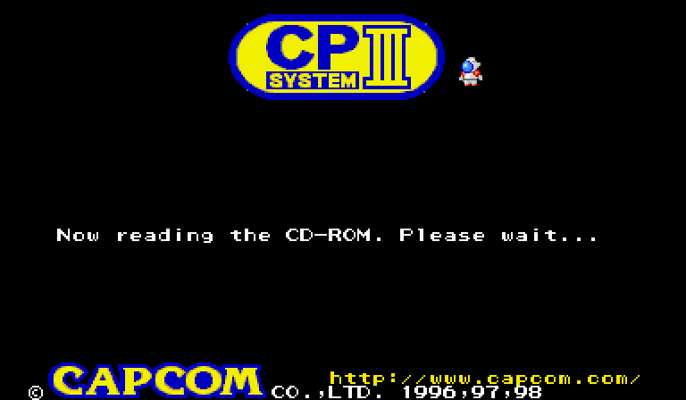
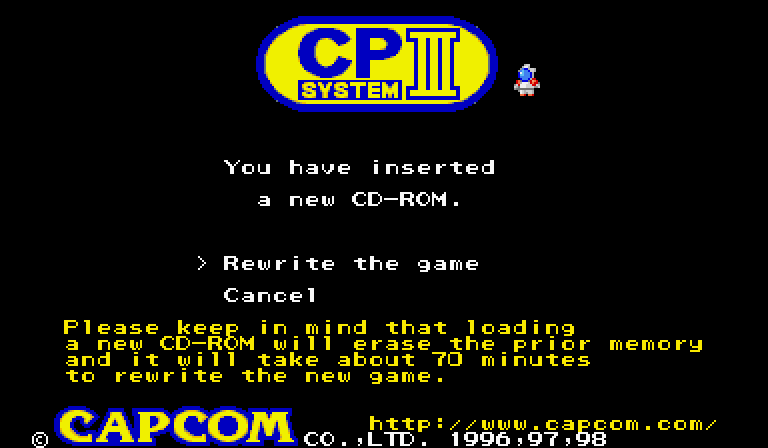
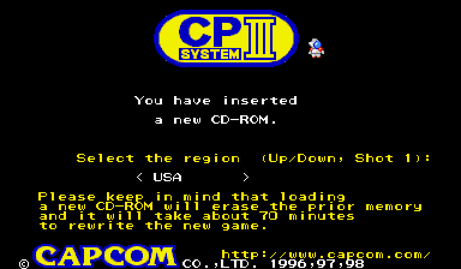
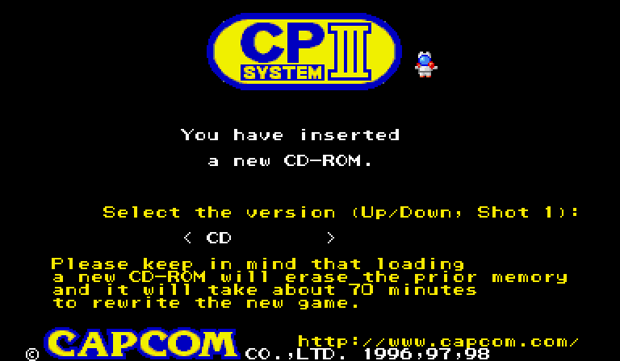
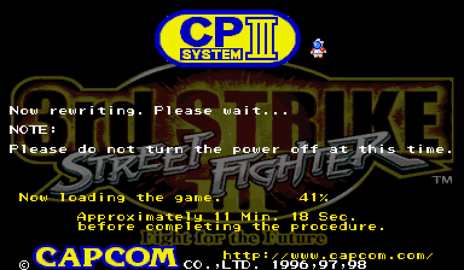
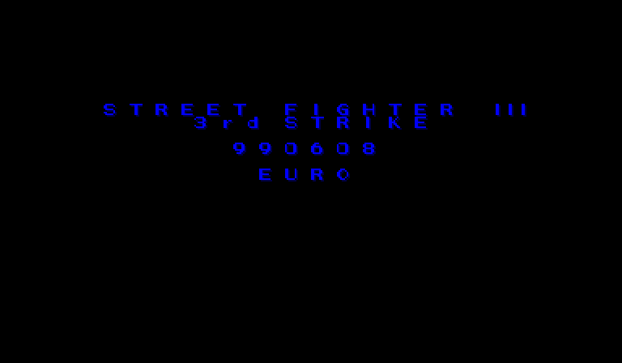
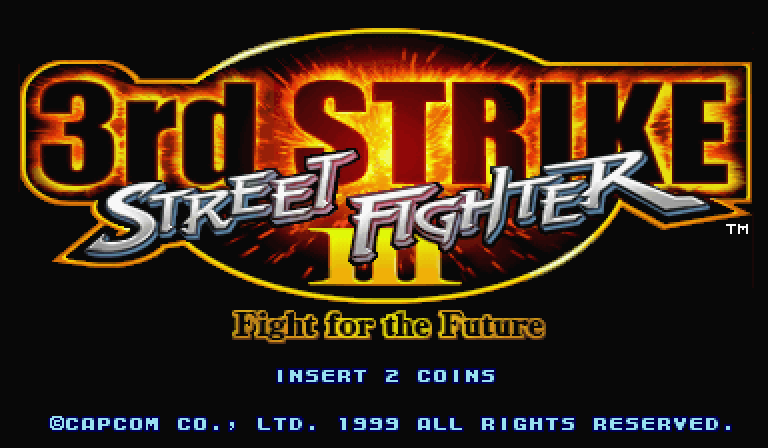
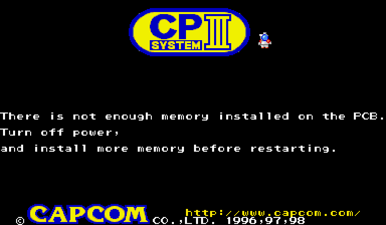

# BIOS CPS3 sans pile

*English version: [README.md](README.md)*

Un seul BIOS pour la flash 29F400 d'une cartouche CPS3 **sans pile** (ou dont la pile
est morte). Il flashe les SIMM depuis les **CD d'origine** et démarre comme le BIOS
d'origine. Il existe en deux versions :

* **cartouche morte** : CPU custom d'origine, clé perdue (clé 0/0) ;
* **SH-2 standard** : CPU custom remplacé par un SH-2 HD6417095 standard.

Le BIOS :

* démarre comme un BIOS d'origine (écran CPS3, contrôle des SIMM, lancement du jeu),
  sans menu ni texte supplémentaire une fois le jeu flashé ;
* reconnaît le CD d'origine parmi : SFIII 3rd Strike (CAP-33S-1 et CAP-33S-2), SFIII
  New Generation (CAP-SF3-3), SFIII 2nd Impact (CAP-3GA-1), JoJo's Venture
  (CAP-JJK-140), JoJo's Bizarre Adventure (CAP-JJM-110), Red Earth / Warzard (CAP-WZD-5) ;
* réécrit les SIMM depuis ce CD comme le BIOS d'origine, en convertissant à la volée
  les SIMM 1/2 au format attendu par la cartouche ;
* demande la **région** et la version **CD / No CD** au lancement de la réécriture ;
* refuse de flasher s'il manque une SIMM dont le jeu a besoin ;
* repropose la réécriture quand les SIMM viennent d'une autre cartouche (Start J1 la
  force).

**Aucune ROM n'est fournie.** Le BIOS se construit à partir de **votre** dump du BIOS
SFIII 3rd Strike Euro et de **vos** images CD. Ce dépôt ne contient que du code
original, les cartes code/données des jeux (un bit par demi-mot : lesquels sont du
code) et la documentation.

## Démarrage rapide

Il faut Python 3 avec numpy, et `chdman` (outils MAME) si vos CD sont des CHD.

1. Dumpez le BIOS d'une cartouche 3rd Strike Euro, ou prenez le fichier MAME
   `sfiii3_euro.29f400.u2` (CRC32 `30bbf293`). La construction le vérifie.
2. Mettez vos images CD dans `iso/`, nommées comme dans [games.txt](games.txt), en
   `.cue` + données :
   * depuis un CHD : `chdman extractcd -i cap-33s-2.chd -o iso/cap-33s-2.cue -ob iso/cap-33s-2.bin`
   * depuis un `.iso` (secteurs de 2048 octets), écrivez `iso/cap-33s-2.cue` :
     ```
     FILE "cap-33s-2.iso" BINARY
       TRACK 01 MODE1/2048
         INDEX 01 00:00:00
     ```
   Un CD absent peut être retiré de `games.txt`. Gardez la ligne 3rd Strike en premier :
   c'est le jeu par défaut.
3. Construisez :
   ```
   python3 tools/build_bios.py       sfiii3_euro.29f400.u2 games.txt bios_dead_cart.u2
   python3 tools/build_bios.py --sh2 sfiii3_euro.29f400.u2 games.txt bios_standard_sh2.u2
   ```
4. Facultatif, pour contrôler le code SH-2 sur un petit émulateur :
   `python3 tools/test_hook.py`

## Sur la carte

1. **Gardez un dump de votre 29F400 d'origine.**
2. Programmez le bon fichier dans la 29F400 de la cartouche : `bios_dead_cart.u2`
   pour un CPU d'origine, `bios_standard_sh2.u2` pour une cartouche équipée d'un SH-2
   standard. La pile peut ensuite être retirée.
3. Insérez le CD du jeu et les SIMM qu'il demande, puis allumez.

### Étapes du chargement

| | |
|---|---|
|  | **1.** Le BIOS lit le CD. |
|  | **2.** Nouveau jeu (ou SIMM d'une autre cartouche) : *Rewrite the game* / *Cancel*, comme avec le BIOS d'origine. Le bouton 1 valide. |
|  | **3.** Région : Japan, Asia, Europe, USA, Hispanic, Brazil, Oceania. Haut/bas pour choisir, bouton 1 pour valider. La région en place s'affiche d'abord. |
|  | **4.** Version : CD ou No CD. En No CD, ni le BIOS ni le jeu n'utilisent ensuite le lecteur : il peut être débranché. |
|  | **5.** Réécriture des SIMM (environ 20 à 25 minutes pour 3rd Strike). Ne coupez pas le courant. |
|  | **6.** Le jeu démarre avec la région choisie. |
|  | **7.** Aux démarrages suivants, avec ou sans CD, le jeu démarre directement, comme avec un BIOS d'origine. |
|  | S'il manque une SIMM dont le jeu a besoin (ou si une 32 Mbit est à la place d'une 64 Mbit), le flash ne démarre pas et l'écran d'erreur d'origine s'affiche. Rien n'a été effacé : éteignez, ajoutez la SIMM, recommencez. |

### Changer de jeu, de région ou de version

* **Autre jeu** : insérez son CD (et les SIMM qu'il demande), le BIOS propose la
  réécriture.
* **Autre région, ou CD / No CD** : insérez le CD et maintenez **Start J1** pendant le
  démarrage, jusqu'au menu *Rewrite the game*. Ça marche aussi après un flash No CD :
  tant que Start est maintenu, le BIOS se sert de nouveau du lecteur (rebranchez-le).
* **SIMM d'une cartouche à pile, ou flashées par l'autre version de ce BIOS** : elles
  sont reconnues et la réécriture est proposée d'elle-même. *Cancel* les garde
  telles quelles.

Choisissez une région où le jeu est sorti : dans MAME, Red Earth en « USA » reste sur
l'écran de classement pendant la démo (Japon = « Warzard » ; Asie et Europe
fonctionnent).

## Principe

Sur une cartouche morte, le CPU lit les données des SIMM 1/2 en clair, mais déchiffre
les instructions avec la clé 0/0. Chaque demi-mot de **code** doit donc être écrit
chiffré avec la clé 0/0, et chaque demi-mot de **données** en clair. Le BIOS d'origine
recopie le CD tel quel ; ce BIOS intercale une conversion dans sa boucle d'écriture :

1. déchiffrement avec la clé du jeu (les données du CD sont celles des SIMM d'une
   cartouche d'origine) ;
2. rechiffrement avec la clé 0/0 des seuls demi-mots de code, d'après une **carte
   code/données** par jeu, rangée dans la zone libre du BIOS.

Avec un SH-2 standard, plus rien n'est chiffré : les SIMM reçoivent simplement le
programme en clair. Seul 2nd Impact, dont le CD est déjà au format cartouche morte,
a besoin de sa carte.

Le jeu est choisi d'après l'identifiant du CD (ou celui écrit en fin de SIMM 1), dans
une table. Son en-tête (drapeaux et sommes des SIMM, comme en 0x1FEC0 d'un BIOS
d'origine) sert ensuite au BIOS pour tous ses contrôles.

**Région et No CD.** Les jeux lisent leur région (0x1FECB) et le drapeau No CD (bit 0
de 0x1FECC) dans l'en-tête de la ROM du BIOS, que le BIOS ne peut pas modifier. Le
BIOS lit lui-même le drapeau No CD à l'allumage (via sa copie de l'en-tête en RAM) pour
ne pas utiliser le lecteur : il reprend le choix enregistré dans les SIMM, sauf si
Start J1 est maintenu.
Pendant le flash, le BIOS écrit une copie de cet en-tête, avec la région et la version
choisies, dans une zone libre des SIMM (`header=` dans `games.txt`). Les lectures de
l'en-tête faites par le jeu sont redirigées vers cette copie (la construction relève
les littéraux 0x1FEC0-0x1FEFF placés près du code). Pour New Generation, 2nd Impact
et Red Earth, la version « No CD » d'origine est une région (« Asie sans CD »,
`nocd=`).

**Réécriture forcée.** Le BIOS d'origine ne propose la réécriture que si
l'identifiant du CD diffère de celui des SIMM. Une marque de 4 octets de la version
qui a flashé (`CPS3` cartouche morte, `SH2 ` SH-2 standard) suit la copie de
l'en-tête. Si elle manque ou si elle est celle de l'autre version, ou si Start J1 est
maintenu, le BIOS se comporte comme pour un nouveau CD.

Détails : [tools/hook.py](tools/hook.py) (code SH-2 commenté) et
[tools/build_bios.py](tools/build_bios.py).

## Fichiers

| Fichier | Rôle |
|---|---|
| `games.txt` | liste des CD : image, clé, carte, options et retouches |
| `maps/*.npz` | cartes code/données des 7 CD |
| `tools/build_bios.py` | construit le BIOS depuis votre dump et vos CD |
| `tools/hook.py` | code SH-2 ajouté au BIOS |
| `tools/sh2asm.py` | mini-assembleur SH-2 |
| `tools/cps3crypt.py` | masque CPS3 (portage du code MAME) |
| `tools/cdimage.py` | lit une image CD ; extrait le programme en clair |
| `tools/test_hook.py` | contrôle le code SH-2 sur un petit émulateur |
| `tools/maptools/` | pour refaire les cartes (analyse statique et relevé MAME) |

### Refaire les cartes (facultatif)

Les cartes de `maps/` ont été faites ainsi :

```
python3 tools/cdimage.py iso/cap-jjk000.cue 02203ee3 01301972 jojo.bin
python3 tools/maptools/map_game.py jojo.bin jojo.npz 800000
# facultatif : relevé MAME du jeu original, puis correction
CARTED=tools/maptools COVP=log_jojo mame jojo -nodrc -autoboot_script tools/maptools/run_coverage.lua -seconds_to_run 500
python3 tools/maptools/fix_map.py jojo.npz log_jojo jojo_fixed.npz
```

3rd Strike : fin `13c000`. 2nd Impact (clés `0 0`) : ajouter `--dead-key`.

## Essai dans MAME

* Cartouche morte : set `cps3boota`. Dans `roms/cps3boota/`, mettez le BIOS renommé
  `no-battery_bios_29f400_for_dead_security_cart.u2` et le CHD du jeu renommé
  `unicd-cps3_for_custom_sh2_v5.chd`.
* SH-2 standard : set `cps3boot`. Le BIOS se renomme
  `no-battery_bios_29f400_for_hd6417095_sh2.u2` et le CHD
  `unicd-cps3_for_standard_sh2_v4.chd`.

Avec un dossier nvram vide, le BIOS demande la réécriture, flashe, puis lance le jeu.

## État

* MAME : réécriture depuis les 7 CD et parties de 20 à 30 minutes avec les deux
  versions. Régions, No CD, contrôle des SIMM et réécriture forcée essayés.
* Vraie carte : essayé sur une cartouche équipée d'un SH-2 standard (démarrage, menus
  région et No CD, JoJo's Venture depuis un CD gravé).

## Limites connues

* La carte code/données vient d'une analyse statique, corrigée par des relevés MAME.
  Du code que l'analyse n'a jamais atteint et qui n'a pas été joué dans MAME pourrait
  rester mal classé (surtout dans des parties rares d'un jeu). 3rd Strike et 2nd
  Impact sont sûrs. Seule la version cartouche morte dépend des cartes (sauf 2nd
  Impact en SH-2 standard).
* Un mot à la fois lu comme donnée et exécuté ne peut pas rendre la valeur d'origine
  sur cartouche morte. Les relevés MAME n'en ont trouvé que dans JoJo et JoJo BA
  (ordonnanceur de tâches), corrigés par les retouches de `games.txt`.
* La copie de l'en-tête lue par les jeux est celle du BIOS 3rd Strike (seules la
  région et le No CD changent), comme avec les autres BIOS sans pile : le contrôle des
  SIMM du menu de test peut afficher des sommes fausses pour les autres jeux.

## Crédits

Claude pour aje_fr. Chiffrement CPS3 : Andreas Naive et l'équipe MAME
(`src/mame/capcom/cps3.cpp`). Le CPS3 et les jeux sont © Capcom.
