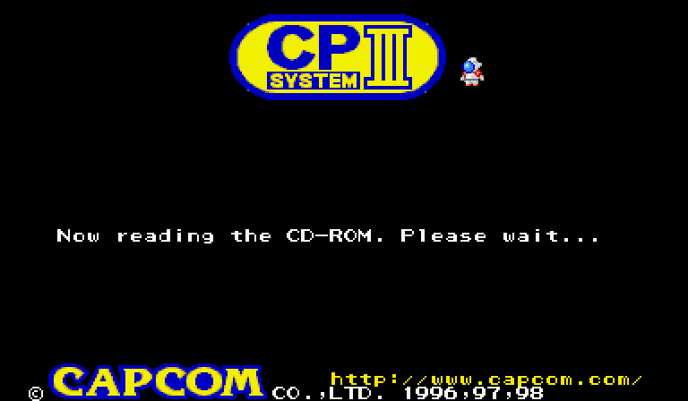
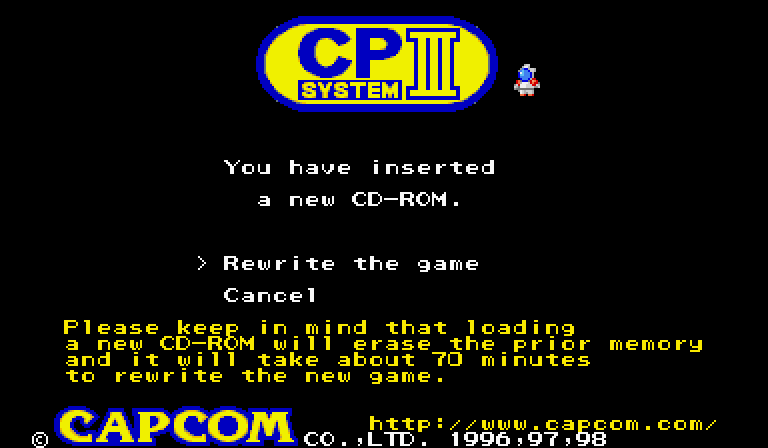
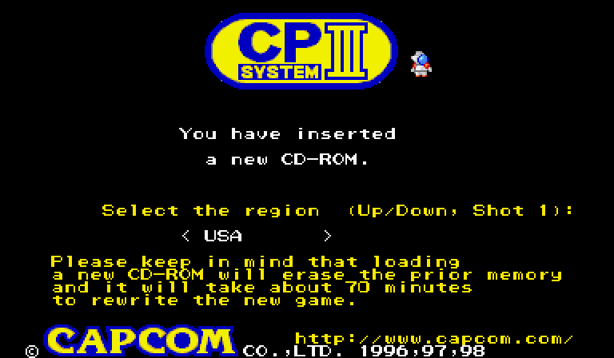
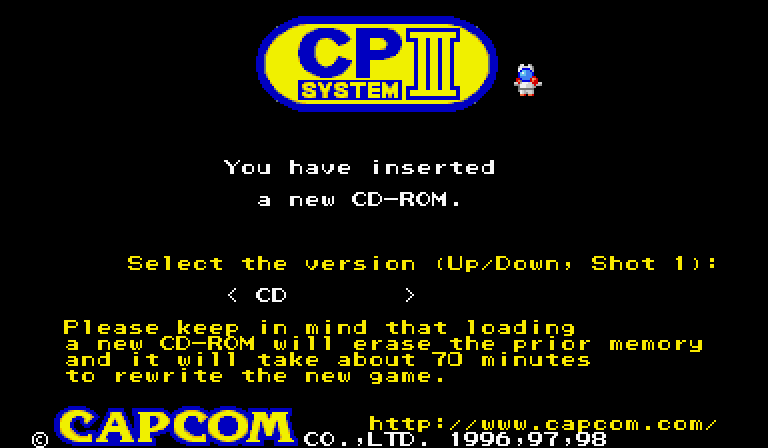
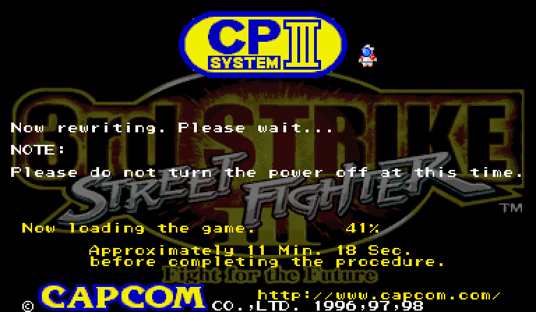
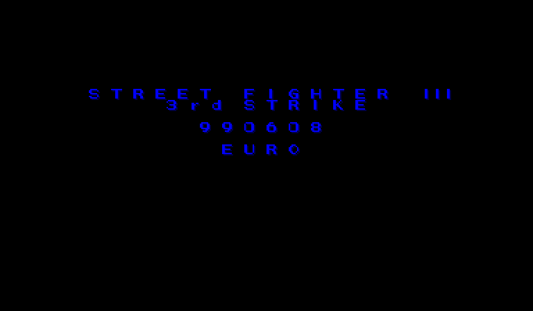
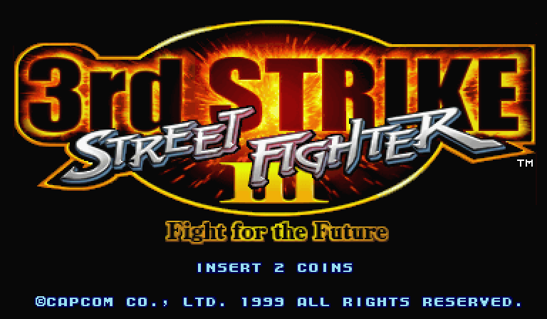
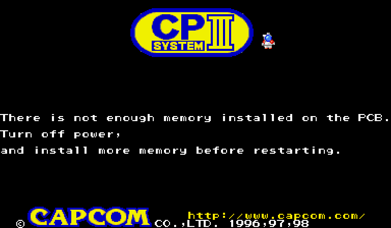

# CPS3 battery-free BIOS

*Version française : [LISEZMOI.md](LISEZMOI.md)*

One BIOS for the 29F400 flash of a CPS3 cart **without battery** (or whose battery
is dead), which flashes the **original CDs** to the SIMMs and boots like the original
BIOS. It exists in two versions:

* **dead cart**: original custom CPU, key lost (key 0/0);
* **standard SH-2**: custom CPU replaced by a standard HD6417095 SH-2.

The BIOS:

* boots like an original BIOS (CPS3 screen, SIMM check, game start), with no extra
  menu or text once a game is flashed;
* recognises the original CD among: SFIII 3rd Strike (CAP-33S-1 and CAP-33S-2),
  SFIII New Generation (CAP-SF3-3), SFIII 2nd Impact (CAP-3GA-1), JoJo's Venture
  (CAP-JJK-140), JoJo's Bizarre Adventure (CAP-JJM-110), Red Earth / Warzard (CAP-WZD-5);
* rewrites the SIMMs from that CD like the original BIOS, converting SIMM 1/2 on the
  fly to the format the cart needs;
* asks for the **region** and the **CD / No CD** version when the rewrite starts;
* refuses to flash when a SIMM the game needs is missing;
* offers the rewrite again when the SIMMs come from another cart (P1 Start forces it).

**No ROM is provided.** The BIOS is built from **your** dump of the SFIII 3rd Strike
Euro BIOS and **your** CD images. This repository holds only original code, the
code/data maps of the games (one bit per half-word: which ones are code), and
documentation.

## Quick start

Requirements: Python 3 with numpy. `chdman` (MAME tools) if your CDs are CHD files.

1. Dump the BIOS of a 3rd Strike Euro cart, or use the MAME file
   `sfiii3_euro.29f400.u2` (CRC32 `30bbf293`). The build checks it.
2. Put your CD images in `iso/`, named as in [games.txt](games.txt), as `.cue` + data:
   * from a CHD: `chdman extractcd -i cap-33s-2.chd -o iso/cap-33s-2.cue -ob iso/cap-33s-2.bin`
   * from a `.iso` (2048-byte sectors), write `iso/cap-33s-2.cue`:
     ```
     FILE "cap-33s-2.iso" BINARY
       TRACK 01 MODE1/2048
         INDEX 01 00:00:00
     ```
   A missing CD can be removed from `games.txt` (keep the 3rd Strike line first: it is
   the default game).
3. Build:
   ```
   python3 tools/build_bios.py       sfiii3_euro.29f400.u2 games.txt bios_dead_cart.u2
   python3 tools/build_bios.py --sh2 sfiii3_euro.29f400.u2 games.txt bios_standard_sh2.u2
   ```
4. Optional check of the SH-2 code on a small emulator: `python3 tools/test_hook.py`

## On the hardware

1. **Keep a dump of your original 29F400.**
2. Program the right file into the 29F400 of the cart: `bios_dead_cart.u2` for an
   original CPU, `bios_standard_sh2.u2` for a cart fitted with a standard SH-2. The
   battery can then be removed.
3. Insert the game CD and the SIMMs it needs, power on.

### Loading steps

| | |
|---|---|
|  | **1.** The BIOS reads the CD. |
|  | **2.** New game (or SIMMs from another cart): *Rewrite the game* / *Cancel*, as with the original BIOS. Button 1 confirms. |
|  | **3.** Region: Japan, Asia, Europe, USA, Hispanic, Brazil, Oceania. Up/down, button 1 confirms. The current region is shown first. |
|  | **4.** Version: CD or No CD. With No CD, the BIOS and the game no longer use the CD drive afterwards: it can be unplugged. |
|  | **5.** The SIMMs are rewritten (about 20 to 25 minutes for 3rd Strike). Do not switch off. |
|  | **6.** The game starts with the chosen region. |
|  | **7.** At the next power-on (with or without CD), the game starts directly, like with an original BIOS. |
|  | If a SIMM the game needs is missing (or a 32 Mbit SIMM sits where a 64 Mbit one is needed), the flash does not start and the original error screen is shown. Nothing has been erased: switch off, fit the SIMM, start again. |

### Changing game, region or version

* **Other game**: insert its CD (and the SIMMs it needs); the BIOS offers the rewrite.
* **Other region or CD / No CD**: insert the CD and hold **P1 Start** while the board
  boots, until the *Rewrite the game* menu appears. This also works after a No CD
  flash: while Start is held, the BIOS uses the CD drive again (plug it back in).
* **SIMMs from a battery cart, or flashed by the other version of this BIOS**: they
  are recognised and the rewrite is offered automatically. *Cancel* keeps them as is.

Choose a region where the game was released: in MAME, Red Earth in "USA" stays on
the ranking screen during the demo (Japan = "Warzard", Asia and Europe are fine).

## How it works

On a dead cart, the CPU reads SIMM 1/2 data in clear but decrypts instruction
fetches with key 0/0. Each **code** half-word must therefore be written encrypted
with key 0/0, and each **data** half-word in clear. The original BIOS copies the CD
as is; this BIOS inserts a conversion in its write loop:

1. decryption with the game key (CD data = SIMMs of an original cart);
2. re-encryption with key 0/0 of the code half-words only, using a **code/data map**
   per game, stored in the free area of the BIOS.

With a standard SH-2 nothing is encrypted: the SIMMs simply get the program in clear
(only 2nd Impact, whose CD is already in dead-cart format, needs its map).

The game is chosen from the CD ID (or the ID written at the end of SIMM 1) in a
table; its header (SIMM flags and sums, as at 0x1FEC0 of an original BIOS) is then
used by the BIOS for all its checks.

**Region and No CD.** Games read their region (0x1FECB) and the No CD flag (bit 0
of 0x1FECC) in the BIOS ROM header, which the BIOS cannot change. The BIOS itself
reads the No CD flag at power-on (through its header copy in RAM) to skip the CD
drive: it is set from the choice stored in the SIMMs, unless P1 Start is held. While flashing,
the BIOS writes a copy of that header, with the chosen region and version, to a free
area of the SIMMs (`header=` in `games.txt`), and the game's reads of the header are
redirected to it (literals 0x1FEC0-0x1FEFF next to code, found at build time). For
New Generation, 2nd Impact and Red Earth the original "No CD" version is a region
("Asia without CD", `nocd=`).

**Forced rewrite.** The original BIOS offers the rewrite only when the CD ID differs
from the SIMM ID. A 4-byte mark of the version that flashed (`CPS3` dead cart,
`SH2 ` standard SH-2) follows the header copy; when it is missing or belongs to the
other version, or when P1 Start is held, the BIOS behaves as for a new CD.

Details: [tools/hook.py](tools/hook.py) (commented SH-2 code) and
[tools/build_bios.py](tools/build_bios.py).

## Files

| File | Role |
|---|---|
| `games.txt` | list of CDs: image, key, map, options and patches |
| `maps/*.npz` | code/data maps of the 7 CDs |
| `tools/build_bios.py` | builds the BIOS from your dump and CDs |
| `tools/hook.py` | SH-2 code added to the BIOS |
| `tools/sh2asm.py` | minimal SH-2 assembler |
| `tools/cps3crypt.py` | CPS3 mask (port of the MAME code) |
| `tools/cdimage.py` | reads a CD image; extracts the program in clear |
| `tools/test_hook.py` | checks the SH-2 code on a small emulator |
| `tools/maptools/` | to remake the maps (static analysis + MAME coverage) |

### Remaking the maps (optional)

The maps in `maps/` were made this way:

```
python3 tools/cdimage.py iso/cap-jjk000.cue 02203ee3 01301972 jojo.bin
python3 tools/maptools/map_game.py jojo.bin jojo.npz 800000
# optional: coverage log of the original game in MAME, then correction
CARTED=tools/maptools COVP=log_jojo mame jojo -nodrc -autoboot_script tools/maptools/run_coverage.lua -seconds_to_run 500
python3 tools/maptools/fix_map.py jojo.npz log_jojo jojo_fixed.npz
```

3rd Strike: end `13c000`. 2nd Impact (`0 0` keys): add `--dead-key`.

## Testing in MAME

* Dead cart: set `cps3boota`, in `roms/cps3boota/`: the BIOS renamed
  `no-battery_bios_29f400_for_dead_security_cart.u2`, the game CHD renamed
  `unicd-cps3_for_custom_sh2_v5.chd`.
* Standard SH-2: set `cps3boot`, BIOS renamed `no-battery_bios_29f400_for_hd6417095_sh2.u2`,
  CHD renamed `unicd-cps3_for_standard_sh2_v4.chd`.

With an empty nvram folder the BIOS asks for the rewrite, flashes, then starts the game.

## Status

* MAME: rewrite from the 7 CDs and 20 to 30 minute games on both versions; regions,
  No CD, SIMM check and forced rewrite tested.
* Real hardware: tested on a cart fitted with a standard SH-2 (boot, region and
  No CD menus, JoJo's Venture from a burnt CD).

## Known limits

* The code/data map comes from static analysis corrected with MAME coverage logs:
  code never reached by the analysis nor played in MAME could stay misclassified
  (mostly in rare parts of a game). 3rd Strike and 2nd Impact are safe. Only the dead
  cart version depends on the maps (except 2nd Impact on standard SH-2).
* A word both read as data and executed cannot give back the original value on a dead
  cart. The MAME logs found it only in JoJo and JoJo BA (task scheduler), fixed by
  the patches in `games.txt`.
* The header copy read by the games is that of the 3rd Strike BIOS (only region and
  No CD change), as with other battery-free BIOSes: the SIMM check of the test menu
  may show wrong sums for other games.

## Credits

Claude for aje_fr. CPS3 encryption: Andreas Naive and the MAME team
(`src/mame/capcom/cps3.cpp`). CPS3 and the games are © Capcom.
